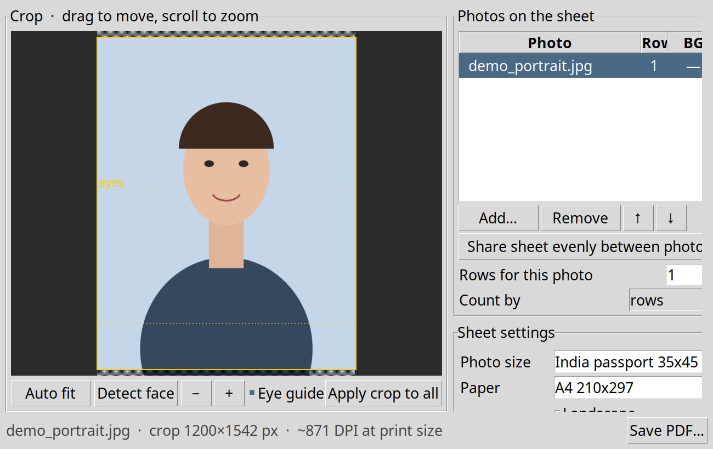
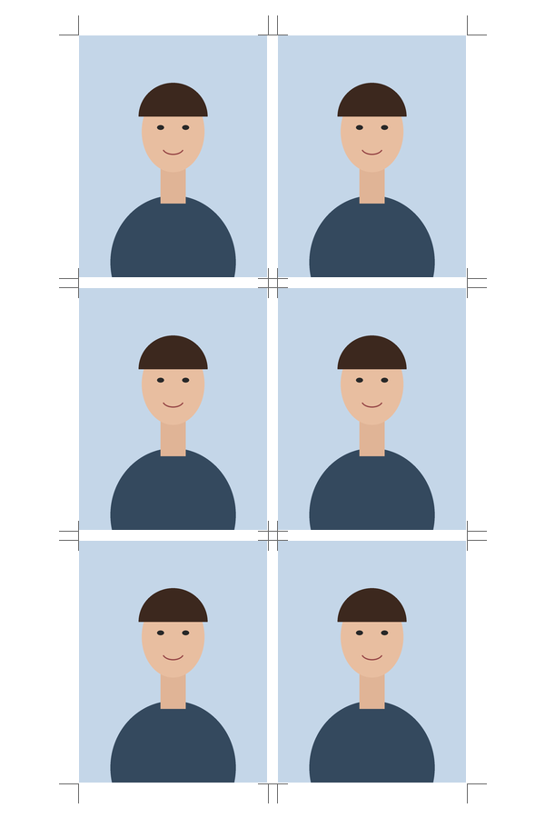

# Passport Photo Studio

[](https://github.com/ArrnB/passport-photo-studio/actions/workflows/tests.yml)


A desktop app that turns ordinary phone photos into **print-ready PDF sheets of
passport photos**, at the exact physical size for India, US, Schengen/UK, China
and custom specs. It handles face-aware cropping, background replacement and a
mixed multi-person layout, so you don't need a photo studio or an online
service that keeps your ID photos.



| Output: 4×6 in sheet with cut marks |
|---|
|  |

*(Screenshots use a drawn placeholder, not a real person.)*

## Features

- **Exact print sizing.** Layout is computed in millimetres and rendered at any DPI,
  so the preview and the printed sheet always agree. It supports A4, A5, Letter, 4×6
  and 5×7 paper in portrait or landscape, with border or corner cut marks.
- **Face-aware auto crop.** OpenCV Haar-cascade face detection places the eyes
  where passport specs expect them. You can then drag or scroll to adjust, with an
  eye-line guide.
- **Several people on one sheet.** Each photo gets its own crop, background,
  adjustments and share of the sheet (whole rows or individual copies). Overflow
  spills onto extra PDF pages.
- **Background replacement** uses a three-stage fallback:
  [rembg](https://github.com/danielgatis/rembg) segmentation → OpenCV GrabCut →
  colour keying. Each mask is sanity-checked and rejected if it keeps almost all or
  almost none of the frame. rembg runs in an **isolated subprocess**, because its
  numba/llvmlite stack can hard-crash (SIGABRT) the interpreter on some Python
  builds, and a crash there must not take the app down.
- **Tone adjustments**: brightness, contrast, saturation, sharpness, warmth,
  auto-levels and B&W, with presets.
- **Print-quality warning.** It shows the effective DPI of each crop, so you know
  when a source photo is too small.
- **HEIC support** for iPhone photos, EXIF rotation handling, plus a text-mode CLI and
  a `--diagnose` flag for troubleshooting background removal.

## Running it

```bash
git clone https://github.com/ArrnB/passport-photo-studio.git
cd passport-photo-studio
python -m venv .venv && source .venv/bin/activate
pip install -r requirements.txt          # Pillow required; OpenCV/HEIC optional

python passport_studio.py                # GUI
python passport_studio.py a.jpg b.jpg    # GUI with photos preloaded
python passport_studio.py --cli a.jpg    # text-prompt mode
```

On Linux, Tkinter may need `sudo apt install python3-tk`.

`passport_sheet.py` is a small single-photo command-line version with only Pillow
as a dependency:

```bash
python passport_sheet.py photo.jpg --size 2x2in --sheet 4x6in --marks corners
```

## Tests

```bash
pip install pytest && pytest
```

The tests cover dimension parsing (mm/cm/inch/presets), DPI-independent grid
fitting, multi-photo page planning and overflow, and crop-box geometry. CI runs
them on every push.

## Project layout

```
passport_studio.py   full app: core layout/crop logic, background removal, Tkinter GUI, CLI
passport_sheet.py    minimal single-photo CLI
tests/               pytest suite for the core logic
```
